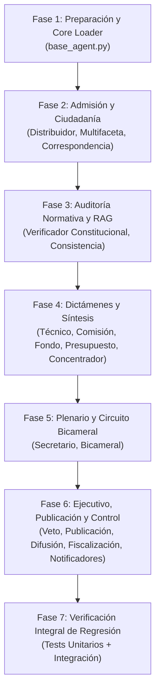

# PLAN: Plan de Implementación Integral de Agentes Legislativos
> **Especificación Asociada:** [docs/specs/SPEC.md](file:///c:/Users/julio/Downloads/Proyectos_2026/v2_proy/v2_proyintegrado/docs/specs/SPEC.md) (SPEC-001)  
> **Ámbito:** Cobertura Total de los 14 Agentes Canónicos + 4 Agentes Auxiliares (18 Componentes)  
> **Nivel de Riesgo Global:** Medio (Centralización declarativa de prompts sin alteración de contratos JSON)

---

## 1. Estrategia y Arquitectura de la Solución

El plan garantiza una transición transparente y segura desde prompts hardcodeados en Python hacia plantillas centralizadas en [agents.yaml](file:///c:/Users/julio/Downloads/Proyectos_2026/v2_proy/v2_proyintegrado/sma_unified/config/agents.yaml):

1. **Desacoplamiento Declarativo:** Cada agente en `agents.yaml` se dota de los atributos `prompt_framework`, `system_prompt_template` y `user_prompt_template`.
2. **Capa Intermedia en [base_agent.py](file:///c:/Users/julio/Downloads/Proyectos_2026/v2_proy/v2_proyintegrado/sma_unified/agents/base_agent.py):** `BaseAgenteLegislativo` implementa el método `get_prompt_templates(nombre_agente)` que recupera las plantillas con sanitización y caché en memoria.
3. **Inyección con Fallback Local:** Cada clase Python en `sma_unified/agents/` intenta renderizar la plantilla YAML. Si el archivo o la clave no están disponibles, utiliza su string interno como valor por defecto, evitando cualquier fallo catastrófico en tiempo de ejecución.
4. **Gobernanza Human-in-the-Loop:** Puntos de control estrictos (Human Gates) en las transiciones de fase conforme a [HUMAN-GATES.md](file:///c:/Users/julio/Downloads/Proyectos_2026/v2_proy/v2_proyintegrado/HUMAN-GATES.md).

---

## 2. Fases de Implementación Secuencial (18 Componentes)



### Fase 1: Preparación y Core Loader
* **Objetivo:** Establecer la infraestructura de carga dinámica en [sma_unified/agents/base_agent.py](file:///c:/Users/julio/Downloads/Proyectos_2026/v2_proy/v2_proyintegrado/sma_unified/agents/base_agent.py).
* **Entregables:**
  * Implementación de `get_prompt_templates(nombre_agente) -> tuple[str, str]`.
  * Verificación de no-regresión con `test_14_agentes.py`.

### Fase 2: Admisión, Entrada y Atención Cívica (3 componentes)
* **Componentes:**
  1. `Distribuidor` ([distribuidor.py](file:///c:/Users/julio/Downloads/Proyectos_2026/v2_proy/v2_proyintegrado/sma_unified/agents/distribuidor.py)) — Framework RTF con Negative Prompting.
  2. `Interaccion_Ciudadana` / `Agente_Multifaceta_Ciudadano` ([multiagente_ciudadano.py](file:///c:/Users/julio/Downloads/Proyectos_2026/v2_proy/v2_proyintegrado/sma_unified/agents/multiagente_ciudadano.py), [ciudadana.py](file:///c:/Users/julio/Downloads/Proyectos_2026/v2_proy/v2_proyintegrado/sma_unified/agents/ciudadana.py)) — Framework CO-STAR + ReAct.
  3. `Correspondencia` ([correspondencia.py](file:///c:/Users/julio/Downloads/Proyectos_2026/v2_proy/v2_proyintegrado/sma_unified/agents/correspondencia.py)) — Framework RTF.
* **Control de Salida:** Contrato de categorías `AGENTE_REGISTRO_LEGISLATIVO`, `AGENTE_ATENCION_CIUDADANA`, `AGENTE_GESTION_CORRESPONDENCIA`.

### Fase 3: Auditoría Normativa y RAG pgvector (2 componentes)
* **Componentes:**
  4. `Verificador_Constitucional` ([verificador_constitucional.py](file:///c:/Users/julio/Downloads/Proyectos_2026/v2_proy/v2_proyintegrado/sma_unified/agents/verificador_constitucional.py)) — Framework CRAFT + CoT con reglas R1-R7 y candado de cita literal.
  5. `Consistencia_Normativa` ([consistencia_normativa.py](file:///c:/Users/julio/Downloads/Proyectos_2026/v2_proy/v2_proyintegrado/sma_unified/agents/consistencia_normativa.py)) — Framework CO-STAR sobre `sistema.articulos_normativos` (pgvector 2048d).
* **Control de Salida:** Preservar `contradicciones`, `severidad_maxima` y `hallazgos` de antinomias.

### Fase 4: Dictámenes Parlamentarios y Concentración Forense (5 componentes)
* **Componentes:**
  6. `Especialista_Tecnico` ([especialista_tecnico.py](file:///c:/Users/julio/Downloads/Proyectos_2026/v2_proy/v2_proyintegrado/sma_unified/agents/especialista_tecnico.py)) — Framework RACE con matriz cuantificada de riesgos.
  7. `Presidencia_Comision` ([presidencia_comision.py](file:///c:/Users/julio/Downloads/Proyectos_2026/v2_proy/v2_proyintegrado/sma_unified/agents/presidencia_comision.py)) — Framework CARE con Orden del Día formal.
  8. `Constitucion_Fondo` ([constitucion_fondo.py](file:///c:/Users/julio/Downloads/Proyectos_2026/v2_proy/v2_proyintegrado/sma_unified/agents/constitucion_fondo.py)) — Framework CO-STAR con Test de Proporcionalidad cuatrifásico.
  9. `Presupuesto` ([presupuesto.py](file:///c:/Users/julio/Downloads/Proyectos_2026/v2_proy/v2_proyintegrado/sma_unified/agents/presupuesto.py)) — Framework CRAFT con 3 escenarios SAFCO.
  10. `Concentrador` ([concentrador.py](file:///c:/Users/julio/Downloads/Proyectos_2026/v2_proy/v2_proyintegrado/sma_unified/agents/concentrador.py)) — Framework CO-STAR con CoT analítico ampliado y emisión PDF en letra negra.
* **Control de Salida:** Claves canónicas `dictamen_tecnico`, `plan_comision`, `dictamen_fondo`, `evaluacion_fiscal`, `expediente_consolidado`.

### Fase 5: Plenario Camaral y Circuito Bicameral (2 componentes)
* **Componentes:**
  11. `Secretario_Camara` ([secretario.py](file:///c:/Users/julio/Downloads/Proyectos_2026/v2_proy/v2_proyintegrado/sma_unified/agents/secretario.py)) — Framework RTF con verificación de quórum legal y doble votación nominal.
  12. `Bicameral` ([bicameral.py](file:///c:/Users/julio/Downloads/Proyectos_2026/v2_proy/v2_proyintegrado/sma_unified/agents/bicameral.py)) — Framework CRAFT con diff textual y freno humano Art. 163 CPE (`PENDIENTE_APROBACION_HUMANA`).
* **Control de Salida:** Claves canónicas `acta_debate` y `ciclo_bicameral`.

### Fase 6: Ejecutivo, Publicación Oficial y Control Posterior (6 componentes)
* **Componentes:**
  13. `Veto_Promulgacion` ([veto_promulgacion.py](file:///c:/Users/julio/Downloads/Proyectos_2026/v2_proy/v2_proyintegrado/sma_unified/agents/veto_promulgacion.py)) — Framework RACE con evaluación multicriterio ponderada.
  14. `Publicacion_Oficial` ([publicacion.py](file:///c:/Users/julio/Downloads/Proyectos_2026/v2_proy/v2_proyintegrado/sma_unified/agents/publicacion.py)) — Framework RTF con procedimiento determinista y cómputo de 15 días de vigencia.
  15. `Difusion_Ciudadana` ([difusion_ciudadana.py](file:///c:/Users/julio/Downloads/Proyectos_2026/v2_proy/v2_proyintegrado/sma_unified/agents/difusion_ciudadana.py)) — Framework BAB + CO-STAR (Lenguaje Claro).
  16. `Fiscalizacion` ([fiscalizacion.py](file:///c:/Users/julio/Downloads/Proyectos_2026/v2_proy/v2_proyintegrado/sma_unified/agents/fiscalizacion.py)) — Framework RACE con inferencia causal abductiva.
  17. `Notificador_Comision` ([notificador_comision.py](file:///c:/Users/julio/Downloads/Proyectos_2026/v2_proy/v2_proyintegrado/sma_unified/agents/notificador_comision.py)) — Framework RTF (HTML formal).
  18. `Notificador_Camara_Opuesta` ([notificador_camara_opuesta.py](file:///c:/Users/julio/Downloads/Proyectos_2026/v2_proy/v2_proyintegrado/sma_unified/agents/notificador_camara_opuesta.py)) — Framework RTF.
* **Control de Salida:** Claves canónicas `evaluacion_veto`, `publicacion_oficial`, `difusion_ciudadana`, `reporte_fiscalizacion`.

### Fase 7: Verificación Integral de Regresión
* Ejecución de las suites automatizadas sin errores de sintaxis ni de contratos de datos.

---

## 3. Puntos de Control Humano (Human Gates Vinculantes)
* **GATE 1 (Revisión de YAMLs):** Validación humana del bloque completo de prompts en `agents.yaml` antes de modificar las llamadas Python.
* **GATE 2 (Validación de Freno Bicameral):** Comprobar que el `AgenteBicameral` mantiene `PENDIENTE_APROBACION_HUMANA` y no salta a promulgación sin firma.
* **GATE 3 (Aprobación Final de Despliegue):** Aprobación del diff consolidado tras validar tests unitarios y frontend linting.

---

## 4. Estrategia de Rollback
1. Si cualquier agente falla al formatear el prompt dinámico del YAML, el bloque `try/except` ejecuta de inmediato el string de fallback original.
2. Reversión atómica total en caso de contingencia:
   ```powershell
   git checkout -- sma_unified/config/agents.yaml sma_unified/agents/
   ```
