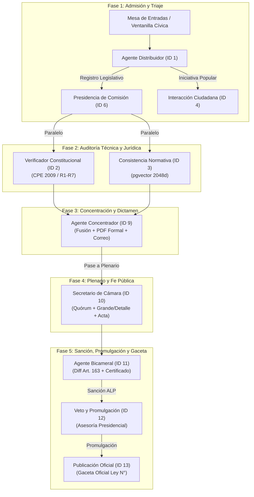

# AUDITORÍA INFORMÁTICA Y TRAZABILIDAD DE AGENTES
## Sistema Multi-Agente Legislativo BolivIA — Prometheus PDT v2.0
> **Ubicación:** `sma_unified/`  
> **Documento de referencia estructural:** `sma_unified/arch.txt`  
> **Ámbito:** Análisis forense de código, flujos de datos inter-agente, generación documental, resiliencia ante errores y discrepancias con el frontend.

---

## 1. RESUMEN EJECUTIVO Y MAPA DE COMUNICACIÓN

El Sistema Multi-Agente (SMA) procesa las iniciativas legislativas mediante un grafo dirigido acíclico (DAG) con puntos de control humano (*Human-in-the-Loop*). 



### Canales y Mecanismos de Comunicación Inter-Agente:
1. **Bus Transaccional Asíncrono (MongoDB Atlas):** Colecciones `mensajes_sistema` y `bitacora_proceso`. Los agentes publican eventos con `task_id`, `agente_origen`, `agente_destino`, `payload` y `timestamp`.
2. **Persistencia Relacional y Semántica (Neon PostgreSQL):** Esquema `sistema.*` (`sistema.proyecto_ley`, `sistema.observaciones_unificadas`, `sistema.sesiones_debate`, `sistema.articulos_constitucion`, `sistema.articulos_normativos`).
3. **Puntos de Control Humano (*Human Gates*):** Entre fases clave (Fase 1 Admisión, Fase 3 Dictamen de Comisión, Fase 4 Votación, Fase 5 Veto/Promulgación), el pipeline no avanza a ciegas; emite un estado `PENDIENTE_APROBACION_HUMANA` a la espera de confirmación desde el Frontend.

---

## 2. CUADRO RESUMEN DE LOS 10 AGENTES SELECCIONADOS

| # | Agente | ID | Framework | Nivel | Temp. | Salida Canónica | Documento Generado |
| :-: | :--- | :-: | :---: | :--- | :-: | :--- | :--- |
| **1** | **Interaccion_Ciudadana** | 4 | CARE | Atención Ciudadana | 0.25 | Markdown + `intencion` | Markdown Claro / Conversación |
| **2** | **Distribuidor** | 1 | CO-STAR | Mesa de Entradas | 0.05 | `categoria` | Registro en `sistema.proyecto_ley` |
| **3** | **Presidencia_Comision** | 6 | CARE | Conducción Comisiones | 0.1 | `plan_comision` | Acta preparatoria y Orden del Día |
| **4** | **Verificador_Constitucional** | 2 | CRAFT | Auditoría Formal | 0.1 | `contradicciones` | Matriz R1-R7 / Correcciones Neon |
| **5** | **Consistencia_Normativa** | 3 | RTF | Armonización Legal | 0.05 | `hallazgos` / `analisis` | Matriz de antinomias vectoriales |
| **6** | **Concentrador** | 9 | RACER | Consolidación y Dictamen | 0.1 | `expediente_consolidado` | **Informe Parlamentario PDF (`fpdf2`)** |
| **7** | **Secretario_Camara** | 10 | RTF | Fe Pública y Plenario | 0.0 | `acta_debate` | Acta formal y cómputo de votos |
| **8** | **Bicameral** | 11 | CO-STAR | Procedimiento Bicameral | 0.1 | `ciclo_bicameral` | **Certificado de Sanción PDF (`fpdf2`)** |
| **9** | **Veto_Promulgacion** | 12 | RACER | Control Ejecutivo/ALP | 0.1 | `evaluacion_veto` | Informe Asesor Presidencial |
| **10** | **Publicacion_Oficial** | 13 | RTF | Gaceta Oficial | 0.0 | `publicacion_oficial` | **Edición Gaceta Oficial PDF (`fpdf2`)** |

---

## 3. AUDITORÍA INFORMÁTICA EXHAUSTIVA POR AGENTE

---

### 1. AGENTE INTERACCIÓN CIUDADANA (ID 4)
* **Archivos fuente:** `sma_unified/agents/multiagente_ciudadano.py`, `difusion_ciudadana.py`, `voz_agent.py`
* **Configuración declarativa:** `sma_unified/config/agents.yaml` (`agente_atencion_ciudadana`), `tasks.yaml` (`Atender_Consulta_Ciudadana`)
* **Nivel:** Atención Ciudadana
* **Arquitectura de Prompting:** **CARE** (Context – Action – Result – Example)
* **Temperatura:** `0.25` (Tono empático, natural y accesible)
* **Modelo LLM:** `nvidia/nemotron-3.5-lightning-30b-a3b`

#### A. Trabajo y función técnica
Ventanilla de atención ciudadana de la ALP. Atiende consultas populares sobre el estado de trámites, canaliza iniciativas populares (Art. 162 CPE) y denuncias cívicas en español y lenguas indígenas (quechua, aymara, guaraní). Traduce la jerga legislativa a lenguaje ciudadano claro.

#### B. Documentos generados
* No genera PDFs formales.
* Genera respuestas conversacionales estructuradas en Markdown:
  1. Estado de la consulta.
  2. Significado en palabras sencillas.
  3. Próximo paso accionable.
  4. Enlace institucional o derivación formal.
* Registra los turnos de diálogo en MongoDB Atlas (`atencion_ciudadana`, `bitacora_chat`).

#### C. Tecnologías utilizadas
* `FastAPI` (endpoints `/api/chat/mensaje`, `/api/chat/audio`, `/api/ciudadana/presentaciones`).
* Motores de voz opcionales: `whisper` / `SpeechRecognition` (STT) y `gTTS` / `pyttsx3` (TTS).
* `MongoDB Atlas` para trazabilidad de conversaciones.

#### D. Comunicación Inter-Agente y Formato de Salida
* **Pasa información a:** **Agente Distribuidor** cuando la consulta es formalizada como proyecto de iniciativa popular.
* **Contrato de Salida (JSON interno de derivación):**
```json
{
  "intencion": "iniciativa_popular",
  "idioma_detectado": "es-BO",
  "respuesta_ciudadana": "## Estado de tu consulta\n- **Estado actual:** ...",
  "requiere_derivacion": true,
  "agente_destino": "AGENTE_REGISTRO_LEGISLATIVO",
  "puntos_clave": ["Agua potable", "El Alto", "Inversión pública"]
}
```

#### E. Manejo de Errores y Contingencias
* **Umbral de Confianza:** Si la confianza en la intención es `< 0.70`, el prompt activa `[REFLEXION]` y no asume datos; solicita respetuosamente aclaración al ciudadano antes de responder.
* **Fallo de LLM:** Activa plantilla determinista indicando los canales formales y horarios de atención de la ALP.

---

### 2. AGENTE DISTRIBUIDOR (ID 1)
* **Archivos fuente:** `sma_unified/agents/distribuidor.py` (función `clasificar_documento`), `base_agent.py`
* **Configuración declarativa:** `sma_unified/config/agents.yaml` (`Distribuidor`), `tasks.yaml` (`Clasificar_Documento`, `Distribuir_Analisis_Especializado`)
* **Nivel:** Mesa de Entradas
* **Arquitectura de Prompting:** **CO-STAR** (Context – Objective – Style – Tone – Audience – Response)
* **Temperatura:** `0.05` (Determinismo formal)
* **Modelo LLM:** `nvidia/nemotron-3.5-lightning-30b-a3b`

#### A. Trabajo y función técnica
Primer filtro oficial de admisión de la ALP bajo Art. 156 CPE y Ley 1630. Analiza el texto extraído del documento y clasifica de forma excluyente en:
1. `AGENTE_REGISTRO_LEGISLATIVO` (proyectos de ley articulados).
2. `AGENTE_ATENCION_CIUDADANA` (peticiones individuales o colectivas).
3. `AGENTE_GESTION_CORRESPONDENCIA` (notas oficiales, cartas, memorándums).

#### B. Documentos generados
* No genera PDFs.
* Crea el registro inicial en PostgreSQL Neon (`sistema.proyecto_ley`) asignando `id_proyecto` correlativo y grabando metadatos del archivo en `sistema.bitacora_proceso`.

#### C. Tecnologías utilizadas
* `doc_extractor.py` (`pdfplumber`, `pypdf`, `python-docx`) para parseo de texto.
* `chat_completion_resiliente` con fallback heurístico determinista (`_clasificar_heuristico`).
* `MongoDB Atlas` (`publicar_mensaje` con tarea de entrada).
* `PostgreSQL Neon` (`guardar_proyecto_ley`).

#### D. Comunicación Inter-Agente y Formato de Salida
* **Pasa información a:** **Presidencia de Comisión** mediante el endpoint `/api/pipeline/phase1`.
* **Contrato de Salida (JSON):**
```json
{
  "categoria": "AGENTE_REGISTRO_LEGISLATIVO",
  "task_id_entrada": "67204f128...",
  "agente_destino_nombre": "Agente_Comision_Legislativa",
  "duracion_ms": 1340
}
```

#### E. Manejo de Errores y Contingencias
* **Timeout de 6 segundos:** Si la inferencia remota tarda más de 6s o falla, conmuta automáticamente a la heurística basada en expresiones regulares (`decreta:`, `asamblea legislativa`, `artículo 1`), garantizando que la mesa de entradas nunca quede congelada.

---

### 3. AGENTE PRESIDENCIA DE COMISIÓN (ID 6)
* **Archivos fuente:** `sma_unified/agents/presidencia_comision.py` (`AgentePresidenciaComision.ejecutar`)
* **Configuración declarativa:** `sma_unified/config/agents.yaml` (`Presidencia_Comision`), `tasks.yaml` (`Planificar_Debate_Comision`)
* **Nivel:** Conducción de Comisiones
* **Arquitectura de Prompting:** **CARE** (Context – Action – Result – Example)
* **Temperatura:** `0.1`
* **Modelo LLM:** `nvidia/nemotron-3.5-lightning-30b-a3b`

#### A. Trabajo y función técnica
Autoridad parlamentaria que aplica la **Regla de Dos Comisiones** (Comisión Principal y Comisión Coadyuvante concurrente). Confecciona el Orden del Día, convoca peritos especializados y estima el plazo reglamentario (15 a 30 días hábiles).

#### B. Documentos generados
* Genera el acta preparatoria de comisión en JSON.
* Persiste en PostgreSQL Neon (`sistema.sesiones_debate`) y en MongoDB Atlas (`actas_detalladas`).

#### C. Tecnologías utilizadas
* `PostgreSQL Neon` (`guardar_sesion_debate_db`).
* `MongoDB Atlas` (`guardar_acta_detallada_mongo`).
* `chat_completion_resiliente` con extracción JSON tolerante a bloques de código.

#### D. Comunicación Inter-Agente y Formato de Salida
* **Pasa información a:** **Verificador Constitucional** y **Consistencia Normativa** para la auditoría técnica paralela.
* **Contrato de Salida (JSON raíz `plan_comision`):**
```json
{
  "plan_comision": {
    "proyecto_id": "101",
    "comision_nombre": "Comisión de Constitución, Legislación y Sistema Electoral",
    "orden_del_dia": [
      { "numero": 1, "punto": "Lectura general del proyecto", "tiempo_estimado_minutos": 20, "responsable": "Secretario" },
      { "numero": 2, "punto": "Audiencia con peritos de la PGE", "tiempo_estimado_minutos": 45, "responsable": "Peritos" }
    ],
    "especialistas_convocados": ["Delegado de la Procuraduría General del Estado"],
    "cronograma_estimado_dias": 15,
    "plan_de_audiencias": "Audiencia pública el día 5 de tratamiento",
    "duracion_ms": 1750
  }
}
```

#### E. Manejo de Errores y Contingencias
* Si el LLM falla, genera un plan reglamentario supletorio con 15 días hábiles, garantizando que el expediente no quede bloqueado en la asignación.

---

### 4. AGENTE VERIFICADOR CONSTITUCIONAL (ID 2)
* **Archivos fuente:** `sma_unified/agents/verificador_constitucional.py` (`verificar_constitucionalidad`)
* **Configuración declarativa:** `sma_unified/config/agents.yaml` (`Verificador_Constitucional`), `tasks.yaml` (`Auditar_Constitucionalidad`)
* **Nivel:** Auditoría Formal y Bloque de Constitucionalidad
* **Arquitectura de Prompting:** **CRAFT** (Context – Role – Action – Format – Target)
* **Temperatura:** `0.1`
* **Modelo LLM:** `nvidia/nemotron-3.5-lightning-30b-a3b`

#### A. Trabajo y función técnica
Auditor preventivo de constitucionalidad. Evalúa el proyecto bajo el filtro decisional **R1 a R7** (competencias privativas/exclusivas, reserva de ley, derechos fundamentales, estructura estatal, jerarquía Art. 410 CPE, precedentes TCP). Dictamina: `COMPATIBLE`, `OBSERVADO` o `INCOMPATIBLE`.

#### B. Documentos generados
* No genera PDFs individuales.
* Registra los hallazgos en `sistema.observaciones_unificadas` y guarda correcciones sugeridas para el legislador en `sistema.correcciones_proyecto` (Neon).

#### C. Tecnologías utilizadas
* `Neon PostgreSQL` (`obtener_articulos_constitucion`, `guardar_observacion_constitucional`).
* `NVIDIA Embeddings` (`llama-3.2-nv-embedqa-1b-v2`) para recuperación de artículos de la CPE.
* `ThreadPoolExecutor` para cotejo concurrente de artículos.

#### D. Comunicación Inter-Agente y Formato de Salida
* **Pasa información a:** **Agente Concentrador** mediante el endpoint `/api/pipeline/agent_constitucional`.
* **Contrato de Salida (JSON):**
```json
{
  "valido": false,
  "confianza": 95,
  "severidad_maxima": "bloqueante",
  "contradicciones": [
    {
      "articulo_proyecto": "Art. 4",
      "articulo_constitucional": "Art. 298.I.15 CPE",
      "tipo_relacion": "contradiccion",
      "severidad": "bloqueante",
      "fundamento": "Invade competencia privativa del nivel central.",
      "cita_proyecto": "El municipio emitirá licencias mineras...",
      "cita_cpe": "Son competencias privativas del nivel central: 15. Régimen de minería..."
    }
  ],
  "articulos_consultados": ["Art. 298 CPE", "Art. 300 CPE"],
  "resumen_ejecutivo": {
    "nivel_riesgo": "ALTO",
    "score_confianza": 94.2
  },
  "duracion_ms": 2980
}
```

#### E. Manejo de Errores y Contingencias
* **Principio de Verificación Citable:** Cualquier observación que no posea cita textual explícita de la CPE y del proyecto se reclasifica como `NEUTRAL` con `verificado: false`.
* **Fallo de Conexión/LLM:** Devuelve `valido: false` y `nivel_riesgo: DESCONOCIDO`, enviando la alerta al Human Gate del frontend para revisión obligatoria.

---

### 5. AGENTE CONSISTENCIA NORMATIVA (ID 3)
* **Archivos fuente:** `sma_unified/agents/consistencia_normativa.py` (`verificar_consistencia_normativa`)
* **Configuración declarativa:** `sma_unified/config/agents.yaml` (`Consistencia_Normativa`), `tasks.yaml` (`Analizar_Consistencia`)
* **Nivel:** Armonización Legal y RAG Vectorial
* **Arquitectura de Prompting:** **RTF** (Role – Task – Format)
* **Temperatura:** `0.05`
* **Modelo LLM:** `nvidia/nemotron-3.5-lightning-30b-a3b`

#### A. Trabajo y función técnica
Compara el proyecto artículo por artículo contra el corpus legal vigente boliviano (Códigos Civil, Penal, Laboral, Ley SAFCO 1178, Ley Marco de Autonomías 031, etc.) almacenado en Neon. Clasifica en: `contradiccion`, `repeticion`, `vacio_llenado`, `complementario`, `sin_relacion`.

#### B. Documentos generados
* Genera la matriz de compatibilidad normativa en JSON.
* Persiste alertas en MongoDB Atlas (`reportes_consistencia`) y correcciones técnicas en `sistema.correcciones_proyecto` (Neon).

#### C. Tecnologías utilizadas
* `Neon PostgreSQL + pgvector` (vectores normalizados de 2048 dimensiones).
* Distancia coseno vectorial sobre `sistema.articulos_normativos`.
* Extracción con `doc_extractor.py` y `parser_normativa.py`.

#### D. Comunicación Inter-Agente y Formato de Salida
* **Pasa información a:** **Agente Concentrador** mediante el endpoint `/api/pipeline/agent_consistencia`.
* **Contrato de Salida (JSON con alias frontend):**
```json
{
  "hallazgos": [
    {
      "norma": "Ley 1178 (SAFCO)",
      "numero_articulo": "Art. 28",
      "articulo_proyecto": "Art. 12",
      "tipo_relacion": "contradiccion",
      "severidad": "alta",
      "justificacion": "Colisiona con la responsabilidad por la función pública.",
      "accion_sugerida": "derogar"
    }
  ],
  "analisis": [...],
  "total_hallazgos": 1,
  "nivel_riesgo_global": "MEDIO",
  "duracion_ms": 2210
}
```

#### E. Manejo de Errores y Contingencias
* Si pgvector está indisponible o no encuentra coincidencias semánticas superiores al umbral (`0.50`), conmuta a búsqueda por coincidencia textual directa (trigram / ILIKE) y marca `pendientes_revision: true`.

---

### 6. AGENTE CONCENTRADOR (ID 9)
* **Archivos fuente:** `sma_unified/agents/concentrador.py` (`ejecutar_concentrador_emisor_notificador`), `bicameral_pdf.py`, `emisor_resultados.py`, `notificador_comision.py`
* **Configuración declarativa:** `sma_unified/config/agents.yaml` (`Concentrador`), `tasks.yaml` (`Concentrar_Observaciones`)
* **Nivel:** Consolidación de Dictámenes y Emisión Documental
* **Arquitectura de Prompting:** **RACER** (Role – Action – Context – Execution – Result)
* **Temperatura:** `0.1`
* **Modelo LLM:** `nvidia/nemotron-3.5-lightning-30b-a3b`

#### A. Trabajo y función técnica
Concentra y sintetiza los insumos de Constitucionalidad, Consistencia y Fondo. Aplica jerarquía normativa para resolver contradicciones entre agentes (CPE > Leyes especiales > Códigos generales). Descarta hallazgos con confianza `< 0.70`, fusiona redundancias y emite el dictamen formal.

#### B. ¿Qué archivos o documentos genera y cómo?
* **Documento Oficial PDF:** Genera el **Informe Parlamentario Oficial en PDF** (`InformeConcentradorFormalPDF` utilizando `fpdf2>=2.8.0` en formato formal de letra negra, membrete parlamentario, tablas de observaciones y sellos institucionales).
* Almacena el PDF físicamente en `uploaded_files/informes/INFORME_CONCENTRADOR_EXP-...pdf`.
* Calcula el hash criptográfico `SHA-256` del archivo.
* Sube el PDF a Google Drive si las credenciales OAuth2 están activas.
* Despacha el PDF adjunto por correo electrónico formal (SendGrid / SMTP) a los miembros de la comisión.

#### C. Tecnologías utilizadas
* `fpdf2>=2.8.0` para compilación binaria PDF.
* `SendGrid` / `smtplib` para notificaciones electrónicas.
* `PostgreSQL Neon` (`sistema.observaciones_unificadas`, `sistema.bitacora_proceso`).
* `MongoDB Atlas` (`expedientes_concentrados`, `mensajes_sistema`).

#### D. Comunicación Inter-Agente y Formato de Salida
* **Pasa información a:** **Secretario de Cámara** y **Presidencia de Comisión** mediante `/api/pipeline/agent_concentrador`.
* **Contrato de Salida (JSON):**
```json
{
  "expediente_consolidado": {
    "nivel_riesgo_general": "BAJO",
    "estado_siguiente": "EN_DEBATE_COMISION",
    "observaciones_integradas": [...],
    "redundancias_fusionadas": 1,
    "resumen_ejecutivo": "Informe favorable con modificaciones de técnica legislativa...",
    "pdf_informe": {
      "filename": "INFORME_CONCENTRADOR_EXP-001_2026.pdf",
      "url_descarga": "/informes/INFORME_CONCENTRADOR_EXP-001_2026.pdf",
      "hash_sha256": "8f3b9c...",
      "bytes": 53873
    }
  },
  "pdf": { "filename": "INFORME_CONCENTRADOR_EXP-001_2026.pdf" },
  "notificacion_comision": { "enviado": true, "destinatarios": 13 }
}
```

#### E. Manejo de Errores y Contingencias
* Si la notificación por correo falla, no aborta el flujo; registra `notificacion_comision.enviado = false` y guarda el PDF localmente.
* Si el modelo LLM tiene alta latencia, activa el motor estructurado determinista garantizando que el PDF parlamentario siempre se compile sin interrupciones.

---

### 7. AGENTE SECRETARIO DE CÁMARA (ID 10)
* **Archivos fuente:** `sma_unified/agents/secretario.py` (`AgenteSecretarioCamara.ejecutar`), `control_legislativo.py`
* **Configuración declarativa:** `sma_unified/config/agents.yaml` (`Secretario_Camara`), `tasks.yaml` (`Registrar_Debate`)
* **Nivel:** Fe Pública y Plenario Camaral
* **Arquitectura de Prompting:** **RTF** (Role – Task – Format)
* **Temperatura:** `0.0` (Determinismo aritmético absoluto)
* **Modelo LLM:** `nvidia/nemotron-3.5-lightning-30b-a3b`

#### A. Trabajo y función técnica
Secretario de Actas y Fe Pública de la Cámara (Diputados o Senadores). Verifica el quórum mínimo legal ($\lfloor \text{curules} / 2 \rfloor + 1$). Extrae automáticamente todos los artículos mediante expresiones regulares (`extraer_articulado_detallado`) y administra la **doble votación reglamentaria**: votación en **Grande** y votación en **Detalle** (artículo por artículo).

#### B. Documentos generados
* Genera el **Acta Oficial de Sesión Plenaria**, el cómputo nominal de votación y el texto sancionado en lectura de cámara.
* Persiste en PostgreSQL Neon (`sistema.sesiones_debate`) y MongoDB Atlas (`actas_detalladas`).

#### C. Tecnologías utilizadas
* `control_legislativo.py`: cómputo estricto de mayorías absolutas y dos tercios (`math.ceil`).
* `hashlib.sha256` para la firma digital del acta.
* `regex` para segmentación de artículos y epígrafes.

#### D. Comunicación Inter-Agente y Formato de Salida
* **Pasa información a:** **Agente Bicameral** mediante el endpoint `/api/pipeline/agent_secretario`.
* **Contrato de Salida (JSON raíz `acta_debate`):**
```json
{
  "acta_debate": {
    "numero_sesion": "SES-102",
    "camara": "DIPUTADOS",
    "quorum_legal": { "total_miembros": 130, "presentes": 115, "quorum_instalado": true },
    "votacion_en_grande": { "resultado": "APROBADO", "favor": 78, "contra": 30, "blancos": 7 },
    "votacion_en_detalle": [
      { "articulo": "Art. 1", "titulo": "Objeto", "resultado": "APROBADO", "favor": 82, "contra": 33 }
    ],
    "estado_siguiente": "EN_TRAMITE_BICAMERAL",
    "hash_acta_sha256": "4b6c81..."
  }
}
```

#### E. Manejo de Errores y Contingencias
* **Quórum no alcanzado:** Si los legisladores presentes no alcanzan el quórum legal, bloquea la votación con `resultado: INSUFICIENTE_QUORUM` y no permite continuar a la siguiente cámara.
* Prohibición absoluta de redondeo hacia abajo en votaciones de dos tercios.

---

### 8. AGENTE BICAMERAL (ID 11)
* **Archivos fuente:** `sma_unified/agents/bicameral.py` (`AgenteBicameral.ejecutar`), `bicameral_pdf.py`
* **Configuración declarativa:** `sma_unified/config/agents.yaml` (`Bicameral`), `tasks.yaml` (`Gestionar_Bicameral`)
* **Nivel:** Trámite Bicameral (Art. 163 CPE)
* **Arquitectura de Prompting:** **CO-STAR** (Context – Objective – Style – Tone – Audience – Response)
* **Temperatura:** `0.1`
* **Modelo LLM:** `nvidia/nemotron-3.5-lightning-30b-a3b`

#### A. Trabajo y función técnica
Administrador del circuito entre Cámara de Origen y Cámara Revisora bajo el Art. 163 de la CPE. Realiza un diff textual entre la versión de Diputados y de Senadores. Controla el plazo de 30 días hábiles de la Revisora y clasifica enmiendas (`ACEPTABLE`, `REQUIERE_INSISTENCIA`, `BLOQUEANTE`). Si ambas cámaras coinciden, emite la **Sanción Legislativa**.

#### B. ¿Qué archivos o documentos genera y cómo?
* Genera el **Certificado Oficial de Sanción Legislativa y Hoja de Seguimiento Bicameral** en PDF (`bicameral_pdf.py` mediante `fpdf2`, con franja tricolor y resumen de votación de ambas cámaras).
* Persiste en PostgreSQL Neon (`sistema.revisiones_bicamerales`).

#### C. Tecnologías utilizadas
* `fpdf2>=2.8.0` para el certificado de sanción descargable.
* `difflib` para cotejo textual entre versiones camarales.
* `PostgreSQL Neon` (`guardar_revision_bicameral`).

#### D. Comunicación Inter-Agente y Formato de Salida
* **Pasa información a:** **Agente de Veto y Promulgación** mediante `/api/pipeline/agent_bicameral`.
* **Contrato de Salida (JSON raíz `ciclo_bicameral`):**
```json
{
  "ciclo_bicameral": {
    "estado_tramite": "SANCIONADO_CONFORME",
    "puede_aprobar": true,
    "circuito_dos_camaras": {
      "camara_origen": { "nombre": "DIPUTADOS", "porcentaje_aprobacion": 67.8, "resultado": "APROBADO" },
      "camara_revisora": { "nombre": "SENADORES", "porcentaje_aprobacion": 71.4, "resultado": "APROBADO" },
      "enmiendas_detectadas": false
    },
    "version_revision": "HUELLA-ALP-2026",
    "ruta_siguiente": "DESPACHO_PRESIDENCIAL"
  },
  "estado_ejecucion": "PENDIENTE_APROBACION_HUMANA",
  "puede_continuar": false
}
```

#### E. Manejo de Errores y Contingencias
* Si surgen discrepancias insolubles, activa el procedimiento de retorno a comisiones (`devolver_a_comision`) o propone convocatoria a Sesión Plenaria de la ALP (Comisión Mixta, Art. 163.III CPE).

---

### 9. AGENTE VETO Y PROMULGACIÓN (ID 12)
* **Archivos fuente:** `sma_unified/agents/veto_promulgacion.py` (`AgenteVetoPromulgacion.ejecutar`)
* **Configuración declarativa:** `sma_unified/config/agents.yaml` (`Veto_Promulgacion`), `tasks.yaml` (`Evaluar_Veto_Promulgacion`)
* **Nivel:** Control Ejecutivo y Presidencia del Estado (Art. 164 CPE)
* **Arquitectura de Prompting:** **RACER** (Role – Action – Context – Execution – Result)
* **Temperatura:** `0.1`
* **Modelo LLM:** `nvidia/nemotron-3.5-lightning-30b-a3b`

#### A. Trabajo y función técnica
Asesor técnico de la Presidencia del Estado. Analiza la ley sancionada por la ALP en el plazo perentorio de 10 días hábiles. Ejecuta un *Debate Prompting* entre la postura del Ejecutivo y la ALP. El Presidente **únicamente PROMULGA o VETA** (parcial o totalmente); no aprueba proyectos, ya que la aprobación es exclusiva del Órgano Legislativo.

#### B. Documentos generados
* Genera el **Informe Asesor Presidencial** con recomendación jurídica y técnica fundamentada.
* Si el Presidente promulga, redacta el borrador del Decreto Supremo de Promulgación.
* Persiste en PostgreSQL Neon (`sistema.evaluaciones_ejecutivas`).

#### C. Tecnologías utilizadas
* `chat_completion_resiliente` con técnica de Debate (Postura A Ejecutivo vs Postura B ALP).
* `PostgreSQL Neon` (`guardar_evaluacion_ejecutiva`).
* `Cosmos/Mongo Atlas` (`registrar_traza_legislativa`).

#### D. Comunicación Inter-Agente y Formato de Salida
* **Pasa información a:** **Agente de Publicación Oficial** (si promulga) o **Devolución a la ALP** (si veta), mediante `/api/pipeline/agent_veto_promulgacion`.
* **Contrato de Salida (JSON raíz `evaluacion_veto`):**
```json
{
  "evaluacion_veto": {
    "recomendacion_asesor": "PROMULGAR",
    "dias_habiles_computados": 3,
    "ruta_siguiente": "TRASPASA_GACETA_OFICIAL",
    "estado_siguiente": "PROMULGADA_POR_EJECUTIVO",
    "paquete_gaceta": {
      "listo_para_traspaso": true,
      "titulo_oficial": "LEY DE MODERNIZACIÓN TECNOLÓGICA",
      "decreto_promulgacion": "Decreto Supremo N° 5210",
      "fecha_promulgacion": "2026-10-29"
    }
  }
}
```

#### E. Manejo de Errores y Contingencias
* **Veto Extemporáneo:** Si el Ejecutivo excede los 10 días hábiles sin pronunciarse, el sistema declara extemporaneidad y faculta la promulgación forzosa por el Presidente de la ALP (Art. 164.III CPE).

---

### 10. AGENTE PUBLICACIÓN OFICIAL (ID 13)
* **Archivos fuente:** `sma_unified/agents/publicacion.py` (`AgentePublicacionOficial.ejecutar`), `gaceta_pdf_generator.py`
* **Configuración declarativa:** `sma_unified/config/agents.yaml` (`Publicacion_Oficial`), `tasks.yaml` (`Publicar_Ley_Oficial`)
* **Nivel:** Gaceta Oficial del Estado Plurinacional de Bolivia
* **Arquitectura de Prompting:** **RTF** (Role – Task – Format)
* **Temperatura:** `0.0` (Determinismo absoluto)
* **Modelo LLM:** `nvidia/nemotron-3.5-lightning-30b-a3b`

#### A. Trabajo y función técnica
Dirección de la Gaceta Oficial. Procedimiento formal sin juicio de contenido: garantiza la publicidad registral de la ley. Asigna el siguiente **número correlativo único de Ley** (leyendo `MAX(numero_ley) + 1` de Neon), calcula la fecha de vigencia (15 días hábiles descontando feriados bolivianos) y registra la norma en el corpus oficial.

#### B. ¿Qué archivos o documentos genera y cómo?
* **Documento Oficial PDF:** Genera la edición facsímil de la **Gaceta Oficial de Bolivia** (`GacetaOficialPDF` en `gaceta_pdf_generator.py` mediante `fpdf2`).
* Calcula el hash SHA-256 de integridad del texto normativo oficial.

#### C. Tecnologías utilizadas
* `fpdf2>=2.8.0` para la compilación de la Gaceta en PDF.
* `PostgreSQL Neon`: actualización de estado en `sistema.proyecto_ley` y bitácora.
* `MongoDB Atlas`: emisión de mensaje "Ley Publicada" hacia Difusión Ciudadana.

#### D. Comunicación Inter-Agente y Formato de Salida
* **Pasa información a:** **Difusión Ciudadana** y **Fiscalización** mediante `/api/pipeline/agent_publicacion`.
* **Contrato de Salida (JSON raíz `publicacion_oficial`):**
```json
{
  "publicacion_oficial": {
    "estado": "PUBLICADA",
    "numero_ley": 1801,
    "numero_ley_str": "Ley N° 1801",
    "fecha_promulgacion": "2026-10-29",
    "fecha_vigencia": "2026-11-20",
    "boletin_oficial": "BOLETÍN OFICIAL N° 1801",
    "hash_texto": "e3b0c44298fc1c149afbf4c8996fb92427ae41e4649b934ca495991b7852b855",
    "estado_siguiente": "LEY_VIGENTE"
  },
  "estado": "PUBLICADA",
  "numero_ley": 1801
}
```

#### E. Manejo de Errores y Contingencias
* **Validación de Promulgación:** Si la decisión ejecutiva previa no fue `PROMULGAR`, detiene el trámite inmediatamente con `ERROR_DATOS_INCONSISTENTES`.
* **Concurrencia de Numeración:** Si la base de datos Neon está inaccesible para leer el máximo correlativo, arroja `RuntimeError: NO_DISPONIBLE` para evitar emitir leyes con numeraciones duplicadas o inventadas.

---

## 4. MATRIZ FORENSE DE DISCREPANCIAS: BACKEND ↔ FRONTEND

| # | Discrepancia Identificada | Causa Raíz en Código | Impacto en el Frontend | Solución Técnica Recomendada |
| :---: | :--- | :--- | :--- | :--- |
| **D1** | **Ruta duplicada en Concentrador** | En `server.py` existen dos endpoints idénticos `@app.post("/api/pipeline/agent_concentrador")` (Línea 1887 y Línea 2159). | El primer endpoint exige `req: ConcentradorRequest` con `sesion_id: str` obligatorio. Si el Frontend lo invoca sin esa clave, FastAPI arroja **HTTP 422 Unprocessable Entity**. | Unificar en un único endpoint en `server.py` que acepte `payload: Dict[str, Any]` y extraiga `sesion_id` con fallback `str(uuid.uuid4())`. |
| **D2** | **Desempaquetado de Claves Raíz (`data`)** | `server.py` envuelve todas las respuestas en `{"success": true, "data": ...}`. Los agentes usan claves canónicas (`dictamen_constitucional`, `expediente_consolidado`, `acta_debate`). | En componentes como `HorizontalAgentFlow.jsx` o `CaseProcessingStatus.jsx`, si se lee `res.expediente_consolidado` en lugar de `res.data.expediente_consolidado`, la interfaz queda en estado `undefined` o pantalla blanca. | Normalizar en `frontend/src/services/api.js` o en los componentes para acceder siempre con `const exp = res.data?.expediente_consolidado || res.expediente_consolidado`. |
| **D3** | **Alias de Consistencia (`hallazgos` vs `analisis`)** | El frontend espera `data.analisis` mientras que el YAML original definía `hallazgos`. | Se solucionó en `consistencia_normativa.py` (Línea 729) inyectando `"analisis": hallazgos` como alias. Debe preservarse para evitar romper `ConsistenciaNormativa.jsx`. | Mantener ambos campos en el retorno de `consistencia_normativa.py`. |
| **D4** | **Escritura en `LOCALAPPDATA` (Windows Sandbox)** | CrewAI intenta escribir por defecto en `C:\Users\<user>\AppData\Local\crewai\credentials\secret.key`. | En entornos con permisos restringidos o sandboxed, genera `PermissionError: [WinError 5] Acceso denegado`, provocando que los agentes fallen con error 500 al instanciarse. | Configurar `os.environ["LOCALAPPDATA"] = os.path.abspath(".temp_localappdata")` al inicio de `server.py`. |
| **D5** | **Descarga de PDFs en el Visor del Frontend** | El frontend invoca `/pipeline/revision_bicameral/{id}/documento_pdf` solicitando un blob. | Si `fpdf2` no está instalado o colisionaba con el viejo `fpdf`, la llamada fallaba silenciosamente y el visor del navegador mostraba un marco gris vacío. | Resuelto tras limpiar el entorno, dejar exclusivamente `fpdf2>=2.8.0` y proteger las clases con `_BasePDF = FPDF if FPDF is not None else object`. |

---

## 5. CRITERIOS DE DISEÑO TRANSVERSALES

1. **Temperaturas bajas (`0.0` - `0.1`) en agentes fedatarios y de cálculo:** Distribuidor (`0.05`), Verificador (`0.1`), Consistencia (`0.05`), Concentrador (`0.1`), Secretario (`0.0`), Bicameral (`0.1`), Veto (`0.1`), Publicación (`0.0`). Garantiza determinismo y reproducibilidad.
2. **Temperaturas altas (`0.25`) en agentes de atención:** Interacción Ciudadana (`0.25`). Permite fluidez conversacional en español y lenguas originarias.
3. **Negative Prompting obligatorio en todos los agentes:** Impide alucinación de leyes, artículos no existentes o fallos TCP falsos.
4. **Structured JSON estricto:** Todos los agentes técnicos responden exclusivamente objetos JSON parseables, sin bloques conversacionales extras.
5. **Cadenas de Verificación (CoVe):** Obligatorias en agentes con impacto legal vinculante (Distribuidor, Verificador Constitucional, Secretario de Cámara y Publicación Oficial).

